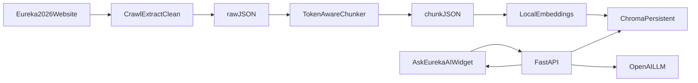
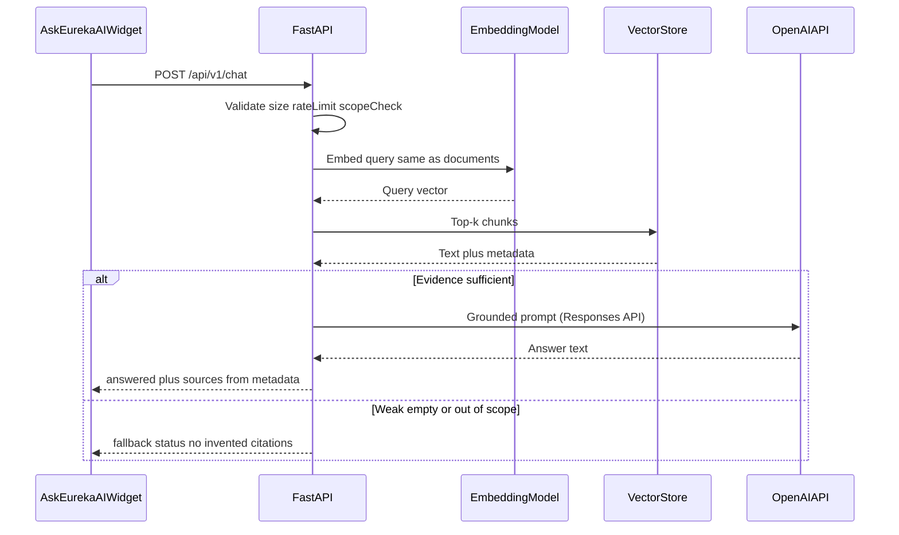

# Eureka Solutions — Ask Eureka AI Architecture

**Project:** Eureka Solutions — Ask Eureka AI  
**Website:** `https://eurekasolutions.in/Eureka2026/`  
**Companion specification:** [problamStatement.md](problamStatement.md)  
**Implementation plan:** [implementation-plan.md](implementation-plan.md)  
**Document type:** System architecture  
**Version:** 2.0  
**Status:** Aligned with problem statement v2.0; confirm website-specific design with the relevant team

This document describes the complete website RAG chatbot. It does not record live crawl results. Categories such as services, case studies, or FAQs are crawl *targets to verify*, not a claim that those pages exist. Invented website facts and claimed live crawls without validated output are forbidden.

---

## 1. Purpose and system context

Visitors on the Eureka 2026 site open **Ask Eureka AI** and ask about the company, services, solutions, projects, industries, published contact information, and other topics that are actually documented in approved public pages. The system retrieves relevant source passages, generates an answer through Groq on the backend, and shows the pages used to support that answer.

If relevant information is not found, the bot must say so and point to the official website or a validated contact route — never fabricate details.

**Primary user journey**

1. Visitor opens `https://eurekasolutions.in/Eureka2026/`.
2. Visitor uses the Ask Eureka AI launcher.
3. The widget POSTs the question to `POST /api/v1/chat`.
4. The backend validates, classifies scope, embeds, retrieves, grounds, and calls Groq.
5. The widget renders a formatted answer plus clickable approved source links.

**Workload assumption:** about 50 visitor sessions per day initially. This is a planning estimate, not a capacity guarantee. Measure actual message volume and provider quotas.

**Hard data rule:** fixture, sample, or fabricated text must never be represented as live website data. Missing values are `null` or empty collections, never invented content.

### 1.1 Ownership

| Role | Responsibility |
| --- | --- |
| End users | Website visitors asking about published Eureka content |
| Frontend team | Chat widget, responsive UX, API integration, answers/sources UI, error states, site integration |
| Backend/RAG team | Crawler, vector index, retrieval/generation, FastAPI, Groq, grounding, security, logs, tests, deployment, handoff |
| Project owner | Crawl scope, answer quality, sources/branding, deployment access, acceptance sign-off |

Frontend and backend may be separate teams; they must share the API contract and joint integration tests.

---

## 2. Phased system (A–F)

Matches problem statement section 4.5. A working crawler alone is not completion of the chatbot.

| Phase | Name | Scope |
| --- | --- | --- |
| **A** | Website data pipeline | Crawl, extract, clean, chunk, validate, report, data ZIP |
| **B** | Retrieval foundation | Embedding model, vector DB, index build/update, retrieval tests |
| **C** | Backend chatbot | Scope checks, prompts, Groq, citations, FastAPI, security, logs |
| **D** | Frontend | Ask Eureka AI widget and agreed API integration |
| **E** | Integration and evaluation | E2E tests, answer quality, failures, accessibility, responsiveness |
| **F** | Deployment and handoff | Hosting, env config, backups, monitoring, runbooks |

**Out of scope unless separately approved:** private/authenticated pages; bypassing CAPTCHA/robots/rate limits; crawling unrelated domains as a search engine; fine-tuning; high-stakes professional advice; guaranteeing every question; collecting unnecessary personal data; login or indefinite conversation history; core site rebuilds beyond the widget; unpaid paid APIs/infra without approval.

### 2.1 End-to-end data flow



- Phase A ends at validated raw/chunk JSON plus reports.
- Phase B reads chunks and writes a persistent index (for example `data/vectorstore/`).
- Phase C is the only process allowed to touch the vector store and OpenAI/LLM API.
- Phase D talks only to the HTTP API, never to LLM APIs or ChromaDB.
- Phase E proves quality and failure handling.
- Phase F puts HTTPS, CORS, secrets, backups, and runbooks in place.

### 2.2 Query-time sequence



---

## 3. Repository layout

Suggested layout from the specification. Modules for crawler, RAG, API, frontend, and deployment must stay separated even if paths differ.

```text
eureka-rag-chatbot/
├── frontend/
├── backend/
│   ├── app/
│   │   ├── main.py
│   │   ├── api/
│   │   ├── rag/
│   │   ├── llm/
│   │   ├── embeddings/
│   │   ├── vectorstore/
│   │   ├── config.py
│   │   └── logging_config.py
│   ├── tests/
│   └── requirements.txt or pyproject.toml
├── crawler/
│   ├── src/
│   ├── scripts/
│   └── tests/
├── data/
│   ├── raw/eureka_website_data.json
│   ├── processed/eureka_website_chunks.json
│   ├── reports/
│   ├── checkpoints/
│   └── vectorstore/
├── frontend-integration/
├── docs/
│   ├── API_CONTRACT.md
│   ├── DEPLOYMENT.md
│   ├── OPERATIONS_RUNBOOK.md
│   └── TEST_REPORT.md
├── tests/
├── .env.example
├── .gitignore
├── README.md
└── problemStatement.md
```

Do not commit a populated live vector-store directory by default if chunk JSON plus rebuild scripts are enough. If an index is included in a delivery archive, document size, provenance, and rebuild.

**Crawler internals** (under `crawler/src/`): discovery, fetcher, parser, cleaner, URL utils, pipeline (export, chunker, validator), hashing, logging. Scripts: `crawl_website.py`, `create_chunks.py`, `run_pipeline.py`, `validate_data.py`.

---

## 4. Phase A — Website data pipeline

Crawler and chunker must **not** require a Groq or embedding API key.

### 4.1 Stack

| Concern | Choice |
| --- | --- |
| Runtime | Python 3.11+ unless the host requires another tested version |
| HTTP | `requests` |
| HTML | `beautifulsoup4` |
| URLs / robots | `urllib.parse`, `urllib.robotparser` |
| Validation | `pydantic` |
| Tokens | `tiktoken` or a tokenizer appropriate to the selected embedding/RAG setup; never character estimates |
| Config | `python-dotenv` |
| Tests | `pytest` with fixtures and mocked HTTP |
| Logs | `logging` or structured logging |
| JS pages | Playwright only as a documented fallback if server-rendered HTML is insufficient |

Pin and test dependency versions.

### 4.2 Crawl boundaries

**Start URL:** `https://eurekasolutions.in/Eureka2026/`

Default: approved origin + `/Eureka2026/` prefix. Extra paths or domains require explicit allow-list after review.

**Rules:** respect `robots.txt` and terms; descriptive User-Agent (project contact where appropriate); limits on pages, depth, timeout, size, retries, delay, concurrency; sitemap + internal links; normalize trailing slashes, fragments, default ports, host casing, tracking parameters; reject external links by default; skip mailto/tel/javascript, irrelevant downloads, unsupported types; prevent loops, query traps, calendar traps, unbounded pagination; validate every redirect; block private/loopback/link-local/internal IPs (SSRF); respect 403/429 and do not bypass controls; record failed/blocked/skipped/low-content/duplicate/out-of-scope; do not treat a temporary failure as deletion.

**Content quality:** remove scripts, styles, tracking, cookie banners, empty nodes, repeated layout. Prefer `main`/`article` with fallback. Preserve contact details, headings, paragraphs, lists, tables, qualifications, context. Do not invent or silently paraphrase.

### 4.3 Component map

| Capability | Location |
| --- | --- |
| URL normalize, scope, SSRF | `crawler` URL utilities |
| Queue, sitemap, link discovery | discovery |
| Fetch, robots, retries, redirects | fetcher |
| Extract fields | parser |
| Boilerplate removal | cleaner |
| Orchestration, checkpoints, reports | crawl pipeline |
| Token-aware chunking | chunker |
| Schema checks | validator |
| Atomic JSON write | export |

Continue after per-page failures unless a configured critical failure occurs (for example start URL unreachable and zero successes). Distinguish complete vs partial crawls.

### 4.4 Raw JSON — `data/raw/eureka_website_data.json`

Versioned root object: schema version, website scope, crawl start/finish, **run ID**, **crawler version**, accurate statistics, list of pages.

Each page record, when available:

| Field | Notes |
| --- | --- |
| `page_id` | Deterministic from normalized canonical/source URL |
| `title`, `meta_description` | Extracted or null |
| `source_url`, `canonical_url`, `final_url` | FR-style traceability |
| `headings` | Ordered `{ level, text }` |
| `content` | Cleaned text with paragraph/section boundaries |
| `content_blocks` | Optional structured paragraphs, lists, tables |
| `internal_links` | Normalized in-scope URLs |
| `content_hash` | SHA-256 of normalized extracted content |
| `http_status`, `crawl_timestamp` | Fetch metadata |
| Extraction warnings | Recorded, not invented text |

Live dataset must not contain placeholder/example content. Fixtures live separately and are clearly named.

### 4.5 Chunk JSON — `data/processed/eureka_website_chunks.json`

| Field | Notes |
| --- | --- |
| `chunk_id` | Deterministic, documented strategy |
| `page_id`, `chunk_index` | Parent and order |
| `source_url`, `canonical_url`, `page_title` | Citations |
| `section_heading` or heading path | Context |
| `content` | Exact extracted text |
| `token_count`, `content_hash`, `chunking_version` | Integrity |
| Optional `last_crawled_at`, content-type | Ops |

Document-level `chunking_config` stores target/overlap/max tokenizer so later reindex knows when to re-chunk.

**Defaults (tune after retrieval eval):** target ~500 tokens, overlap ~75, max 700, min 80 where practical. Split on headings, paragraphs, lists/tables, semantic sections. Do not mix unrelated pages/topics. Every nonempty chunk respects max tokens.

### 4.6 Validation, incremental, CLI

Validate: JSON/schema, missing fields, invalid URLs, duplicate IDs/hashes, empty/short pages/chunks, over-limit tokens, broken chunk→page references, status counts, coverage, complete vs partial.

Atomic writes: temp file → validate → replace. Keep previous valid output if a run fails.

Modes: `full` and `incremental`. Hash-based new/changed/unchanged/potentially missing. Re-chunk on text or chunking-config change. Stale/missing only after documented verification. Checkpoints for resume.

```bash
python scripts/crawl_website.py --max-pages 200
python scripts/create_chunks.py --target-tokens 500 --overlap-tokens 75
python scripts/run_pipeline.py --mode full
python scripts/run_pipeline.py --mode incremental
python scripts/validate_data.py
```

Configurable: base URL, path allow-list, exclusions, delay, page limit, depth, timeouts, retries, concurrency, User-Agent, tokenizer, chunk sizes, output paths, log level, dry-run.

### 4.7 Error taxonomy

| Class | Behavior |
| --- | --- |
| Out of scope | Skip; do not fetch |
| Blocked (robots, 403) | Record; continue |
| 404 | Record; incremental does not delete on one miss |
| 429 / 5xx | Backoff/retry then fail |
| Timeout / size / type | Record failure |
| Empty / low content | Warn; do not fabricate |
| Duplicate URL / content | Dedupe; report |
| Redirect out of bounds | Do not follow |

---

## 5. Phase B — Embeddings and vector store

### 5.1 Recommended initial design

| Choice | Rationale |
| --- | --- |
| **ChromaDB** persistent on the backend host | Modest load; durable disk + tested backup |
| **Local embeddings** `sentence-transformers/all-MiniLM-L6-v2` | Configurable baseline; evaluate on real Eureka questions |
| **pgvector** | Alternate if the team wants SQL/backups in one system |

Do not implement both stores unless the owner asks. Define a **storage interface** so the chat API does not depend on Chroma specifics.

The browser must never connect to ChromaDB. Collection name example: `eureka_website_chunks`. Persist under `data/vectorstore/` (env-configured). Test restart persistence, backup/restore, collection existence, counts.

### 5.2 Embedding rules

- Embed each final chunk with the configured document model.
- Embed every user question with the **same compatible model and preprocessing**.
- Never compare vectors from different models/dimensions.
- Metadata: `chunk_id`, `page_id`, URL, title, section heading, chunk text, content hash, **embedding model name/version**, **index version**.
- Idempotent upsert by `chunk_id`.
- Skip re-embed of unchanged chunks unless model or preprocessing version changes.
- Document full reindex after an embedding-model change.
- Keep credentials and file paths out of client code.

### 5.3 Retrieval behavior

Starting values; tune on a golden set:

- Top-k about 5–8 (config `TOP_K`, example 6).
- Metadata filters only when intent and data model support them.
- Distance/cosine thresholds only after verifying store semantics — scores are not probabilities.
- Optional rerank if approved for cost/runtime.
- De-duplicate overlapping chunks; limit redundant same-page passages.
- Return text + source metadata together.
- Weak, contradictory, empty, or irrelevant context → transparent fallback, not a forced answer.

Do not rebuild the entire index inside a user chat request. Isolate crawl/index jobs from interactive traffic.

---

## 6. Phase C — Backend service and Groq

The FastAPI app is the **only** component allowed to access the vector store and Groq.

### 6.1 Request pipeline

1. **Validate and normalize:** Unicode NFC, whitespace collapse, length bounds (1 to 2,000 chars).
2. **Contextual Referent Resolution:**
   - Stateless, privacy-conscious resolution of pronouns (`they`, `their`, `them`, `it`, `its`, `that service`) and elliptical follow-ups (`"What about in Goa?"`).
   - Resolves referents using bounded client-sent `conversation_history` (up to 6 recent turns).
   - Conversational history is strictly utilized for search query formulation; it is **never** treated as authoritative ground-truth factual source evidence.
3. **Layered Scope Classification:**
   - Detects queries unrelated to Eureka Solutions' business scope (food/recipes e.g. *rajma chawal*, sports/cricket, general trivia, weather, entertainment, academic coding/math, prompt overrides).
   - Returns a friendly, persona-aligned redirect mentioning only verified service categories (Software Engineering, Cloud Infrastructure, AI & Intelligent Automation) without invoking vector retrieval or Groq.
4. **Semantic Retrieval:**
   - Embeds query and searches persistent ChromaDB index (`eureka_website_chunks`) using cosine similarity.
   - De-duplicates chunks and applies same-page concentration limits.
5. **Evidence Sufficiency Evaluation:**
   - Evaluates retrieved candidate relevance.
   - Categorizes queries into internal outcome categories:
     - `ANSWERABLE_IN_SCOPE`: Supported by verified website evidence -> Generate grounded answer -> `answered`.
     - `IN_SCOPE_INSUFFICIENT`: Company-related inquiry with missing or incomplete facts (e.g. Goa office, stock ticker, undocumented pricing) -> Explain known facts (e.g. Mumbai base) vs unknown facts conversationally -> `insufficient_evidence`.
     - `UNRELATED_OUT_OF_SCOPE`: Irrelevant to Eureka Solutions -> Friendly redirect -> `out_of_scope`.
     - `AMBIGUOUS`: Insufficient context -> Clarification prompt or focused search -> `insufficient_evidence` / `out_of_scope`.
     - `TEMPORARILY_UNAVAILABLE`: Upstream vector store or LLM timeout/failure -> `temporarily_unavailable` (HTTP 503).
6. **Controlled Prompt Builder:**
   - Constructs evidence-grounded prompt with strict grounding constraints.
   - Enforces friendly conversational tone (avoids robotic meta-hedging like *"Based on the available information"*).
   - Distinguishes verified facts from unknown facts; forbids inventing offices, awards, case studies, or URLs.
7. **Groq Generation:** Isolated client with bounded output tokens, 30s timeout, and exponential backoff retry.
8. **Citation Validation & Output Sanitization:**
   - Constructs and validates citations against approved domain `https://eurekasolutions.in/`.
   - Sanitizes hallucinated markdown links and removes inline bracketed markers for clean UI rendering.
9. **Status Mapping & Metrics:**
   - Maps internal outcome to public `ChatStatus`.
   - Logs structured, sanitized latency and outcome metrics with `request_id`.

Treat crawled text and user messages as **untrusted data**, not instructions. Ignore prompt-injection in scraped pages. Do not reveal system prompts, keys, logs, or infra. Do not execute tools from visitor messages. Do not use outside knowledge to fill Eureka-specific gaps.

### 6.2 HTTP API (`/api/v1` unless documented otherwise)

#### `GET /health/live`

Process up. No secrets. Example: `{"status":"ok"}`.

#### `GET /health/ready`

Config, vector-store access, collection existence. Non-success if required services are down. Do not call Groq for every health check.

#### `POST /api/v1/chat`

Request:

```json
{
  "message": "What services does Eureka Solutions provide?",
  "session_id": "optional-random-client-session-id",
  "language": "auto"
}
```

- `message` required, trimmed, max length configurable.
- Empty/unsupported payloads → clear validation error.
- `session_id` optional; no PII/secrets; no persistent memory unless separately designed.
- `language`: `auto` or a supported code; preserve user language where reliable; document tested languages.

Success:

```json
{
  "request_id": "server-generated-request-id",
  "answer": "Eureka Solutions provides ...",
  "status": "answered",
  "sources": [
    {
      "title": "Services",
      "url": "https://eurekasolutions.in/Eureka2026/example-page/",
      "snippet": "A short excerpt that supports the answer."
    }
  ],
  "message": null
}
```

Stable statuses: `answered`, `insufficient_evidence`, `out_of_scope`, `temporarily_unavailable`. Insufficient evidence: safe fallback in `answer`, empty or relevant `sources`, **no fabricated citations**.

#### Optional `POST /api/v1/feedback`

Thumbs up/down + request ID + optional reason. No names/email unless approved. Document retention first.

**Errors:** consistent JSON, no stack traces; proper HTTP codes for bad input, too large, rate limit, unavailable, internal. Include `request_id`. Never send provider dumps, paths, prompts, or credentials to the browser.

**Docs:** OpenAPI for development; production docs public vs restricted is an explicit decision. Deliver schema to the frontend team.

### 6.3 Groq

Backend-only. Configurable model ID (availability and limits change). Official docs at implementation time: [API](https://console.groq.com/docs/api-reference), [models](https://console.groq.com/docs/models), [rate limits](https://console.groq.com/docs/rate-limits).

```dotenv
GROQ_API_KEY=replace_with_secret
GROQ_MODEL=replace_with_current_supported_model_id
GROQ_TIMEOUT_SECONDS=30
GROQ_MAX_RETRIES=2
```

Never put `GROQ_API_KEY` in frontend env, static JS, git, logs, or the ZIP.

Generation: send only needed retrieved context; bounded output tokens and timeouts; retries for transient errors using `Retry-After` when present; no endless retries on validation errors; friendly public messages + sanitized server logs.

**Prompt:** answer only from retrieved evidence; do not invent services, projects, clients, prices, guarantees, capabilities, contacts, policies; admit insufficient evidence; short paragraphs, headings/bullets; no unnecessary question echo; sources only those the backend supplies; distinguish fact vs uncertainty; keep user language.

LLM output is **not** a citation validator. Backend constructs and validates the `sources` array.

### 6.4 Scope, Conversational Tone, and Grounded Fallbacks

The bot acts as the friendly, professional **Ask Eureka AI** assistant representing Eureka Solutions. It avoids sounding like a robotic document-search error message.

1. **Unrelated Inquiries (Out of Scope):**
   - Questions about food (*e.g., "Do they provide rajma chawal?"*), sports (*e.g., "Who won a cricket match yesterday?"*), or general trivia are recognized without wasting retrieval or LLM tokens.
   - The chatbot responds with a friendly, warm redirect (e.g. *"Haha, rajma chawal isn't one of the business services I can help you verify! 😊 As the Ask Eureka AI assistant, I can help you explore Eureka Solutions' software, cloud integration, and enterprise services. What would you like to know?"*).
   - Only verified business capabilities from the knowledge base are referenced in redirects.

2. **Company-Related Inquiries with Missing Evidence (Insufficient Evidence):**
   - When a visitor asks about Eureka Solutions but the knowledge base cannot verify the fact (e.g., an office in Goa, specific unverified client awards, or custom hardware manufacturing):
   - The chatbot **distinguishes known facts from unknown facts**. (e.g., *"The information I found identifies Mumbai as the base for Eureka Solutions, but I couldn't confirm whether they have an office in Goa. To avoid giving you the wrong information, I'd recommend checking with the company directly."*).
   - It never invents office locations, phone numbers, email addresses, or URLs.
   - Genuine contact details (*info@eurekasolutions.in*, *+91 92247 83200*) are shared only when retrieved from verified source chunks (e.g. Privacy Policy).

3. **Conversational Tone Standards:**
   - Avoid mechanical phrases like *"Based on the available information provided in the website content"*.
   - Avoid excessive disclaimers or repetitive homepage URL dumps.
   - Use humor or emojis sparingly and naturally.
   - Distinguish verified capabilities (AI Strategy, Agentic AI, WhatsApp Bot) from unverified case studies honestly without fabricating project counts or client lists.

**Citations:** Built and validated on the backend from chunk metadata (`title`, `url`, `snippet`). In line with the UI specification, citations remain verified internally for regression testing while being kept hidden from display in the end-user chat widget.


---

## 7. Phase D — Frontend widget

Add an Ask Eureka AI launcher to the existing site. Do not rebuild the whole website. Stack may be the site’s React/Next.js or current stack.

### 7.1 UI

- Approved branding, typography, visual style where available.
- Visible launcher **Ask Eureka AI**; open/close panel/modal on desktop and mobile.
- Title, brief scope statement, message list, input, send.
- Starter/example questions only for topics actually in the crawled corpus.
- Distinct visitor vs bot messages; typing indicator; no duplicate submit in flight; reasonable cancel/close.
- Render paragraphs, breaks, lists, headings; **sanitize/escape**; never render arbitrary HTML from the model.
- Source titles as accessible links, new tab, safe `rel` attributes.
- States: no answer, out of scope, rate limit, backend down, network error.
- In-widget conversation while open; do not claim cross-session history unless implemented; reset/new-chat if history is shown.
- Do not ask for personal details unless a separate approved requirement exists.

### 7.2 Accessibility and responsive

Keyboard navigation, visible focus, accessible names/roles, contrast, readable type, mobile touch targets, no overflow on small screens, reduced-motion, announce loading/new answers to AT.

### 7.3 Request behavior

- API base URL from deployment config, not hard-coded.
- `POST /api/v1/chat` JSON; handle 2xx and non-2xx.
- Frontend char limit aligned with backend; backend remains authoritative.
- No Groq key, vector path, or privileged credentials in the browser. Never call Groq from the client.
- CORS configured for the exact production origin; do not “fix” CORS by disabling browser security.

### 7.4 Handoff

Backend delivers: API base URL per environment, OpenAPI/schema, sample payloads, error-state definitions, allowed origins, test endpoint.

Frontend delivers: widget source, required env vars, setup instructions, staging integration-test record.

---

## 8. Security, privacy, abuse

- Secrets in env or secret manager; only `.env.example` placeholders in packages.
- CORS allow-list of expected origins; no production wildcard unless justified.
- HTTPS for public site/API.
- Body/message limits; per-IP/session rate limits (proxy-aware).
- Bounded concurrency and provider timeouts.
- Schema validation before processing.
- Chat endpoint queries the corpus only — no arbitrary URL fetch from user input.
- Vector files and DB ports private to the API process.
- No secrets, full prompts, or unnecessary PII in logs.
- Default: minimal/no persistent transcripts unless approved, with retention policy.
- Pin dependencies; patch; least-privilege SSH/admin/DB.
- Backup/restore: raw JSON, chunks, vector index, config (no secrets), code.
- Scraped content and visitor input are untrusted.

---

## 9. Deployment, performance, operations

### 9.1 Shape (~50 users/day baseline)

Evaluate a small VPS for FastAPI + persistent ChromaDB if CPU/RAM/disk and latency tests pass. Not a capacity guarantee.

Pieces: HTTPS reverse proxy; FastAPI under a process manager or container; persistent Chroma + crawl metadata; secrets; rotating logs; scheduled/manual crawl and reindex; backups and rollback.

Frontend may stay on the existing host. Split hosting is fine with HTTPS, CORS, and API base URL set correctly.

### 9.2 Environment (placeholders only)

```dotenv
APP_ENV=development
APP_HOST=0.0.0.0
APP_PORT=8000
API_BASE_PATH=/api/v1
ALLOWED_ORIGINS=http://localhost:3000,https://eurekasolutions.in
GROQ_API_KEY=replace_with_secret
GROQ_MODEL=replace_with_current_supported_model_id
GROQ_TIMEOUT_SECONDS=30
GROQ_MAX_RETRIES=2
VECTOR_STORE=chroma
CHROMA_PERSIST_DIRECTORY=./data/vectorstore
CHROMA_COLLECTION=eureka_website_chunks
EMBEDDING_MODEL=sentence-transformers/all-MiniLM-L6-v2
TOP_K=6
RELEVANCE_THRESHOLD=configure_after_evaluation
MAX_MESSAGE_CHARACTERS=2000
RATE_LIMIT_PER_MINUTE=configure_for_host
LOG_LEVEL=INFO
```

Parser must validate comma-separated origins and numerics. If pgvector is chosen, add DB URL via secrets and document migrations/backups.

**Stages:** local (fixtures, mocked Groq) → staging (live crawl, full index, production-like CORS) → production (HTTPS, real secrets, persistence, backups, rate limits, monitoring).

**Readiness:** start only when deps are up; index persists across restarts; rebuild/rollback tested; proxy timeouts/headers safe; no secrets in git/artifacts; public errors without stacks; log rotation; restore tested; Groq model/quota checked before release.

### 9.3 Performance

Measure median and p95 in staging. Bounded timeouts/retries. Load embedding model at startup; reuse DB clients. Cache only with defined invalidation. Fallback on quota, slowness, missing index, backend failure. Cap retrieved context and output tokens. Log retrieval vs generation latency separately. Load-test and resize if needed.

### 9.4 Logging and runbook

Log: request ID, timestamp, outcome, total/retrieval/generation latency, selected source IDs, sanitized error category. Do not store full messages/responses by default.

Detect: process/readiness down; vector store missing or empty; crawl failures or unusually few pages; unexpected index counts; Groq errors/timeouts/limits; high latency/errors; excessive rate-limits.

Runbook: restart, logs, quota errors, vector restore, full reindex, crawl refresh, key rotation, rollback.

---

## 10. Testing architecture

Unit, integration, E2E, security, and answer quality. Not screenshots or a single lucky query. CI must not hammer the live site. Mock Groq in most tests; one controlled staging smoke against the real provider when credentials exist.

**Crawler:** normalization, scope, sitemap/links, robots, redirects, HTTP errors, timeouts, retries, extraction, Unicode, duplicates, atomic writes, resume, incremental, schema, IDs, hashes, tokens, overlap, max size; live JSON only when a live crawl is claimed.

**Retrieval:** golden questions tied to real pages; expected page in top-k; relevance vs keyword-adjacent; duplicates; spelling/natural phrasing; chunking/embedding change impact. Label synthetic fixtures.

**API:** schema, empty/long messages, in-scope/ambiguous/out-of-scope/insufficient evidence, Groq success/malformed/timeout/429/5xx/missing model, vector down/empty, sources only from retrieved metadata, request IDs, safe errors, retries, rate limits, CORS, no secrets in logs/bodies.

**Frontend:** open/close desktop/mobile; loading/success/empty/out-of-scope/offline/timeout/rate-limit; keyboard/focus/labels; sources; XSS; duplicate submit; reset.

**E2E quality:** direct page facts; multi-page combine; ambiguous; absent facts; unrelated general knowledge; prompt injection / secret requests; unsupported premises. Answers must match evidence; bad evidence → fallback.

---

## 11. Deliverables and definition of done

### 11.1 Artifacts

1. Runnable source for the agreed scope  
2. Dependency lock/config and `.env.example`  
3. `.gitignore` (venv, caches, user logs, secrets, local DBs, temp)  
4. Raw and chunk JSON  
5. Crawl/validation report and test report  
6. API contract with payloads and errors  
7. README (setup, test, crawl, reindex, troubleshooting)  
8. Deployment guide and operations runbook  
9. Problem statement  
10. `eureka-rag-data.zip` (crawler/chunker source, tests, docs, report, **actual** generated data)  
11. Integration note: API URLs per env, current model config, known limits, unresolved issues — **no secrets**

If the live site was unreachable, say so. Do not present placeholders as extracted content.

### 11.2 README must cover

Python/runtime; install/run for crawler, index builder, backend, widget; env vars without secrets; tests; live crawl within scope; chunks/embeddings/index/API; local chat smoke with citations; pointing frontend at local/staging/prod; refresh without corruption; Groq key rotation and model change; limits, troubleshooting, rollback. Every command tested in a clean environment; live-credential steps labeled.

### 11.3 Acceptance (summary)

| Area | Must demonstrate |
| --- | --- |
| Pipeline | In-scope crawl, honest report, valid versioned JSON, chunk metadata, size/overlap tests, full+incremental, no delete on transient fail |
| Retrieval/API | Reproducible index, same embed model for query/docs, health+chat contracts, grounded answers, real citations, fallbacks, no crash on provider/index failure, secrets backend-only |
| Frontend | Launcher on approved pages, responsive/accessible/on-brand, sources, loading/errors, configurable API URL, no browser Groq |
| Deploy/docs | Clean README, staging/prod settings, HTTPS/CORS/limits/logs/persistence, backup/reindex/rollback, test report with remaining limits |

**Done** when crawled data is validated; index is reproducible; FastAPI grounds and cites; widget is on the live site at agreed breakpoints; tests cover quality and failures; HTTPS/secrets/CORS/rate limits/backups are verified; docs and ZIP exist; owner has reviewed limitations.

A crawler-only ZIP or a frontend mock without a real backend and knowledge base is **not** done.

---

## 12. Assumptions

1. Live site is public; otherwise fixtures only, clearly labeled.  
2. Server-rendered HTML is enough unless inspection proves otherwise.  
3. Default crawl scope is `/Eureka2026/` on `eurekasolutions.in`.  
4. Tokenizer used for chunk counts is documented and compatible with the RAG setup.  
5. Embedding baseline is MiniLM unless evaluation replaces it (then full reindex).  
6. Groq model ID is confirmed from current provider docs at deploy time.  
7. No page category exists until discovery records it.  
8. Conversation history is in-widget only unless storage is separately approved.

Re-check these before claiming extraction, retrieval, or production success.
