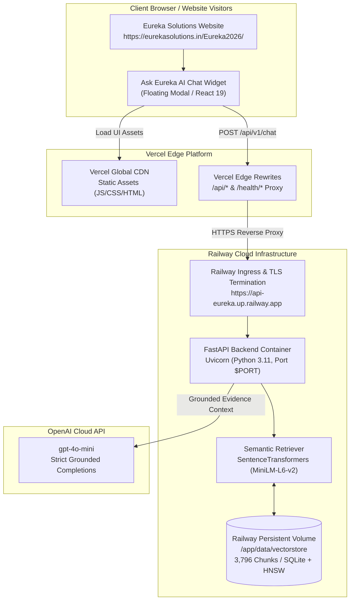
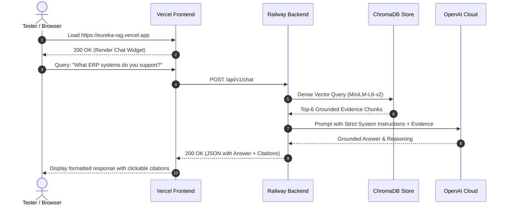

# Ask Eureka AI — Full-Stack Deployment Plan
## Production Deployment Guide for Railway (Backend) & Vercel (Frontend)

**Document:** `docs/deployment-plan.md` (Mirrors root `deployment-plan.md`)  
**Project:** Eureka Solutions — Ask Eureka AI RAG Chatbot  
**Target Live Website:** `https://eurekasolutions.in/Eureka2026/`  
**Target Architecture:** Decoupled Architecture (Vercel Edge Frontend + Railway Container Backend)  
**Primary LLM Provider:** OpenAI (`gpt-4o-mini`, Responses API / Chat Completions)  
**Vector Database:** ChromaDB Persistent Store (3,796 Chunks, 102 Crawled Pages)  
**Embedding Model:** `sentence-transformers/all-MiniLM-L6-v2` (384 dimensions)  
**Frontend Framework:** React 19 + TypeScript + Vite  
**Backend Framework:** FastAPI (Python 3.11) + Uvicorn  
**Status:** Ready for Staging & Production Deployment  

---

## 1. Executive Summary & Deployment Architecture

This deployment plan outlines the step-by-step procedure to deploy the entire **Ask Eureka AI** system to modern cloud platforms:
- **Backend Service on Railway**: Runs the containerized Python 3.11 FastAPI service, houses the persistent ChromaDB vector store, executes dense neural embeddings with SentenceTransformers, and orchestrates grounded LLM completions with OpenAI.
- **Frontend Widget on Vercel**: Builds and distributes the React 19 / TypeScript / Vite conversational application across Vercel's global Edge CDN for sub-50ms static asset delivery and edge rewrites.
- **Host Integration on Eureka Solutions Website**: Embeds the compiled widget onto `https://eurekasolutions.in/Eureka2026/` via a non-intrusive floating launcher and shadow-isolated modal.



---

## 2. Pre-Deployment Readiness Checklist

Before initiating deployments, verify that all release gates are satisfied:

| Release Gate / Requirement | Status | Verification Command / Evidence |
|---|---|---|
| **Backend Automated Tests** | Passed | `pytest tests/` (105/105 passed, 0 failures) |
| **Frontend Production Build** | Passed | `cd frontend && npm run build` (Clean build in 2.24s) |
| **Frontend Type Checks & Lint** | Passed | `tsc -b` and `oxlint` passing with 0 errors |
| **Knowledge Base Integrity** | Verified | 3,796 chunks across 102 pages indexed in ChromaDB |
| **Manifest Compatibility** | Verified | `index_manifest.json` matches MiniLM-L6-v2 (dim 384) |
| **Zero Secrets in Git** | Enforced | `.env` is gitignored; `.env.example` contains placeholders only |
| **Accounts & Keys Ready** | Ready | OpenAI API key with active quota; Railway & Vercel accounts active |

---

## 3. Phase 1 — Backend Deployment on Railway

Railway is chosen for the backend because it natively supports Docker containers, persistent storage volumes, private networking, and automatic TLS termination.

### 3.1 The ChromaDB Persistence Challenge & Solution

> [!IMPORTANT]
> **Understanding Container Ephemerality:**
> Standard cloud containers use an ephemeral filesystem. If the container restarts or redeploys without persistent storage, any data written to `/app/data/vectorstore` is lost. Because `data/vectorstore/*` is excluded from git by default in `.gitignore`, Railway's build must be provided with the vector store.

You have two supported strategies:

#### Strategy A: Railway Persistent Volume (Recommended for Production)
1. In Railway, provision a **Persistent Volume** mounted at `/app/data/vectorstore`.
2. Seed the volume either via Railway CLI upload or by whitelisting `data/processed/eureka_website_chunks.json` so the entrypoint can auto-build if the volume is newly created.

#### Strategy B: Self-Contained Docker Image (Fastest One-Click Staging)
1. The included `deployment/Dockerfile` has been configured to copy `data/processed/` and `data/vectorstore/` directly into the container image.
2. In your Git repository, ensure `data/vectorstore` and `data/processed` are tracked for deployment (or use git force-add `git add -f data/vectorstore data/processed`).
3. The image deploys self-contained and boots instantly on Railway with zero manual file transfers.

---

### 3.2 Configuration Files for Railway

The repository includes the required configuration files:

1. **`railway.json`** (Project Root):
   ```json
   {
     "$schema": "https://railway.com/railway.schema.json",
     "build": {
       "builder": "DOCKERFILE",
       "dockerfilePath": "deployment/Dockerfile"
     },
     "deploy": {
       "startCommand": "sh -c 'exec uvicorn backend.app.main:app --host 0.0.0.0 --port ${PORT:-8000} --workers 2 --proxy-headers --forwarded-allow-ips \"*\"'",
       "healthcheckPath": "/health/ready",
       "healthcheckTimeout": 300,
       "restartPolicyType": "ON_FAILURE",
       "restartPolicyMaxRetries": 3
     }
   }
   ```
2. **`deployment/Dockerfile`**:
   - Multi-stage build based on `python:3.11-slim`.
   - Runs as non-root user `appuser:appgroup` (UID 10001).
   - Dynamically evaluates `${PORT:-8000}` passed by Railway.
   - Built-in readiness health check against `/health/ready`.

---

### 3.3 Step-by-Step Railway Deployment (Console Walkthrough)

#### Step 1: Push Code to GitHub
Ensure your repository is pushed to GitHub:
```bash
git add .
git commit -m "feat: configure deployment artifacts for Railway and Vercel"
git push origin main
```
*(If choosing Strategy B, ensure you force-add the vector store: `git add -f data/vectorstore data/processed && git commit -m "chore: include vector assets for deployment" && git push`)*.

#### Step 2: Create Railway Project
1. Log in to [Railway.app](https://railway.app/).
2. Click **"New Project"** -> Select **"Deploy from GitHub repo"**.
3. Choose your repository: `Eureka-Chat-bot`.
4. Railway will automatically detect `railway.json` and prepare to build using `deployment/Dockerfile`.

#### Step 3: Attach Persistent Volume (Optional / Strategy A)
1. Click on the newly created backend service in Railway canvas.
2. Navigate to the **"Volumes"** tab.
3. Click **"Add Volume"**.
4. Set Mount Path to: `/app/data/vectorstore`.
5. Click **"Add Volume"**.

#### Step 4: Configure Environment Variables
Navigate to the **"Variables"** tab of your service and add the following production variables:

| Variable Name | Production Value | Description |
|---|---|---|
| `APP_ENV` | `production` | Production mode (disables Swagger docs) |
| `APP_HOST` | `0.0.0.0` | Listen on all network interfaces |
| `API_BASE_PATH` | `/api/v1` | URL route prefix |
| `OPENAI_API_KEY` | `sk-proj-...` *(Your Secret Key)* | Official OpenAI API Key |
| `OPENAI_MODEL` | `gpt-4o-mini` | Recommended high-speed production model |
| `LLM_PROVIDER` | `openai` | Active provider (`openai` or `groq`) |
| `OPENAI_MAX_OUTPUT_TOKENS`| `1024` | Token limit for LLM generation |
| `OPENAI_TIMEOUT_SECONDS` | `30.0` | Timeout per LLM call |
| `CHROMA_PERSIST_DIRECTORY`| `/app/data/vectorstore` | Persistent ChromaDB storage path |
| `CHROMA_COLLECTION` | `eureka_website_chunks` | Collection name |
| `EMBEDDING_MODEL` | `sentence-transformers/all-MiniLM-L6-v2` | Dense neural embedding model |
| `EMBEDDING_DIMENSION` | `384` | Embedding dimensionality |
| `TOP_K` | `6` | Retrieval chunk count |
| `EVIDENCE_MIN_SCORE` | `0.45` | Grounded relevance score threshold |
| `MAX_CITATIONS` | `5` | Maximum citation links in response |
| `RATE_LIMIT_PER_MINUTE` | `60` | Client rate limit ceiling |
| `CANONICAL_BASE_URL` | `https://eurekasolutions.in/Eureka2026/` | Base URL for citation validation |
| `ALLOWED_ORIGINS` | `https://eurekasolutions.in,https://*.vercel.app` *(update with exact Vercel URL)* | Whitelisted CORS origins |

#### Step 5: Configure Networking & Health Check
1. In the **"Settings"** tab:
   - Under **Networking**, click **"Generate Domain"** (e.g. `eureka-backend-production.up.railway.app`).
   - Under **Deploy**, verify:
     * **Healthcheck Path**: `/health/ready`
     * **Healthcheck Timeout**: `300` seconds (allows initial model download/cache on first start).
2. Click **"Deploy"**.

---

### 3.4 Verification of Backend Deployment

Once Railway finishes building and deploying, verify using `curl`:

```bash
# 1. Process Liveness Check (Fast HTTP probe)
curl -f https://<YOUR-RAILWAY-DOMAIN>/health/live
# Expected response: {"status": "ok"}

# 2. Application Readiness Check (Verifies ChromaDB + 3,796 records)
curl -f https://<YOUR-RAILWAY-DOMAIN>/health/ready
# Expected response:
# {"status": "ready", "vector_store": "ok", "collection": "eureka_website_chunks", "chunks_count": 3796}

# 3. Live Grounded Query Smoke Test
curl -X POST https://<YOUR-RAILWAY-DOMAIN>/api/v1/chat \
  -H "Content-Type: application/json" \
  -H "Origin: https://eurekasolutions.in" \
  -d '{"message": "What ERP software does Eureka Solutions implement?"}'
```

Verify that the response returns `status: "answered"`, citation links with `https://eurekasolutions.in/Eureka2026/...`, and a populated `X-Request-ID` header.

---

## 4. Phase 2 — Frontend Deployment on Vercel

Vercel hosts the React 19 / Vite single-page application and widget.

### 4.1 Edge Proxy & Rewrites Architecture (`vercel.json`)

To prevent Cross-Origin Resource Sharing (CORS) friction and eliminate exposing raw backend endpoints directly in client code, Vercel provides **Edge Rewrites**.

The repository includes `frontend/vercel.json`:
```json
{
  "$schema": "https://openapi.vercel.sh/vercel.json",
  "framework": "vite",
  "cleanUrls": true,
  "rewrites": [
    {
      "source": "/api/:match*",
      "destination": "https://<YOUR-RAILWAY-DOMAIN>/api/:match*"
    },
    {
      "source": "/health/:match*",
      "destination": "https://<YOUR-RAILWAY-DOMAIN>/health/:match*"
    }
  ]
}
```

> [!TIP]
> **Why this solves CORS completely:**
> When the user opens the Vercel site (`https://eureka-rag.vercel.app`), the browser sends `/api/v1/chat` to `https://eureka-rag.vercel.app/api/v1/chat`. Vercel's edge proxy transparently forwards the request to Railway over HTTPS server-side. The browser treats this as same-origin, avoiding pre-flight CORS failures.

---

### 4.2 Step-by-Step Vercel Deployment (Console Walkthrough)

#### Step 1: Import GitHub Project in Vercel
1. Log in to [Vercel.com](https://vercel.com/).
2. Click **"Add New..."** -> **"Project"**.
3. Select your GitHub repository: `Eureka-Chat-bot`.

#### Step 2: Configure Root Directory & Build Settings
1. In the project setup screen, locate **"Root Directory"**:
   - Click **"Edit"** and select `frontend`.
2. Vercel automatically detects the framework as **Vite**.
3. Verify build settings:
   - **Framework Preset**: `Vite`
   - **Build Command**: `npm run build` (or `tsc -b && vite build`)
   - **Output Directory**: `dist`
   - **Install Command**: `npm install` (or `npm ci`)

#### Step 3: Update `frontend/vercel.json` with Railway Domain
Before triggering the deployment or in your code, ensure `frontend/vercel.json` has your actual Railway domain:
```json
{
  "rewrites": [
    {
      "source": "/api/:match*",
      "destination": "https://eureka-backend-production.up.railway.app/api/:match*"
    },
    {
      "source": "/health/:match*",
      "destination": "https://eureka-backend-production.up.railway.app/health/:match*"
    }
  ]
}
```

#### Step 4: Configure Frontend Environment Variables
In Vercel's **"Environment Variables"** section, add:

| Variable Name | Recommended Value | Notes |
|---|---|---|
| `VITE_EUREKA_API_BASE_URL` | `https://eureka-backend-production.up.railway.app` | Backend target URL |
| `VITE_MOCK_API` | `false` | Must be `false` for live RAG pipeline |
| `VITE_REQUEST_TIMEOUT_MS` | `30000` | 30-second timeout matching LLM SLA |

#### Step 5: Deploy
Click **"Deploy"**. Vercel will build the TypeScript assets and deploy to a production URL (e.g. `https://eureka-rag.vercel.app`).

---

## 5. Phase 3 — CORS Synchronization & Security Hardening

Now that both domains are live:
1. **Frontend Domain**: `https://eureka-rag.vercel.app`
2. **Backend Domain**: `https://eureka-backend-production.up.railway.app`

### 5.1 Update Railway CORS Whitelist
Go back to Railway -> Backend Service -> **"Variables"**:
Update `ALLOWED_ORIGINS` to include the specific Vercel URL and the live Eureka Solutions website:

```env
ALLOWED_ORIGINS=https://eureka-rag.vercel.app,https://eurekasolutions.in,http://localhost:5173,http://localhost:3000
```
> [!CAUTION]
> Do NOT add trailing slashes (e.g. `https://eureka-rag.vercel.app/` is invalid). `backend/app/config.py` strictly validates origins and will reject entries with paths or trailing slashes.

Railway will automatically perform a rolling redeploy of the backend container with the updated CORS policy.

---

## 6. Phase 4 — End-to-End Verification & Staging Smoke Tests

Execute the 5-point verification matrix:



### 6.1 Test Matrix

| Test ID | Test Scenario | Input Message | Expected Outcome |
|---|---|---|---|
| **SMOKE-01** | **Backend Readiness** | `GET /health/ready` | HTTP 200, `vector_store: ok`, `chunks_count: 3796` |
| **SMOKE-02** | **Core ERP Knowledge** | `"What ERP software does Eureka Solutions implement?"` | HTTP 200, status `answered`, mentions Oracle NetSuite / Sage, verified citation URLs |
| **SMOKE-03** | **Contact & Support** | `"How can I get in touch with sales?"` | HTTP 200, status `answered`, returns contact form / office contact info |
| **SMOKE-04** | **Out-of-Scope Query** | `"Write a recipe for chocolate cake"` | HTTP 200, status `out_of_scope`, polite business refusal, zero citations |
| **SMOKE-05** | **Rate Limiting Guard** | Send >60 requests in 60s from same IP | HTTP 429 `Too Many Requests`, returns `Retry-After` header |

---

## 7. Phase 5 — Embedding into the Live Website (`eurekasolutions.in`)

To mount the widget onto the live target site `https://eurekasolutions.in/Eureka2026/`:

### 7.1 Embed Snippet
Paste the following snippet directly before the closing `</body>` tag on the host site:

```html
<!-- ========================================================================= -->
<!-- Eureka Solutions — Ask Eureka AI Chatbot Mount                           -->
<!-- ========================================================================= -->
<div id="eureka-chat-root"></div>

<!-- Production CSS -->
<link rel="stylesheet" href="https://eureka-rag.vercel.app/assets/index-CotMEkT1.css" />

<!-- Production ES Module Script -->
<script type="module" src="https://eureka-rag.vercel.app/assets/index-DXfAP5vx.js"></script>

<!-- Customization & Host Config (Optional overrides) -->
<script>
  window.__EUREKA_CONFIG__ = {
    apiBaseUrl: "https://eureka-backend-production.up.railway.app",
    initialOpen: false,
    theme: "light",
    primaryColor: "#004B87"
  };
</script>
```

---

## 8. Operations, Monitoring, & Troubleshooting Runbook

### 8.1 Real-Time Telemetry & Log Inspection

- **Railway Logs:**
  In Railway console, select the backend service and click **"Deploy Logs"** or **"HTTP Logs"**.
  CLI alternative:
  ```bash
  railway logs
  ```
  Check for lines like:
  ```
  INFO: Chroma vector store connected successfully. Records count: 3796
  INFO: Semantic retriever initialized and ready.
  INFO: OpenAI client configured with model 'gpt-4o-mini'.
  ```

- **Vercel Logs:**
  In Vercel dashboard, click **"Deployments"** -> select active deployment -> **"Real-Time Logs"**. Monitor edge rewrites and static asset traffic.

---

### 8.2 Top 6 Common Deployment Issues & Instant Resolutions

#### 1. HTTP 503 "collection_empty_or_missing"
- **Symptom:** `/health/ready` returns 503; chat endpoint responds with `temporarily_unavailable`.
- **Root Cause:** The Railway container was deployed without the pre-built vector database, or the persistent volume is empty.
- **Resolution:**
  1. Whitelist `data/vectorstore` in Git (`git add -f data/vectorstore && git push origin main`), OR
  2. SSH / run command in Railway: `python -m scripts.build_index --rebuild` (uses `data/processed/eureka_website_chunks.json` to index into the volume in ~25 seconds).

#### 2. HTTP 503 "LLM provider unavailable"
- **Symptom:** Backend starts, but chat prompts return error `LLM provider unavailable`.
- **Root Cause:** `OPENAI_API_KEY` is missing in Railway Variables, or the OpenAI account has run out of credits.
- **Resolution:** Check OpenAI developer platform billing; re-enter valid API key in Railway Variables and trigger a redeploy.

#### 3. HTTP 403 Forbidden / CORS Blocked
- **Symptom:** Browser console shows `Access-Control-Allow-Origin header missing or invalid`.
- **Root Cause:** The Vercel URL has not been added to `ALLOWED_ORIGINS` in Railway.
- **Resolution:** Add `https://<YOUR-VERCEL-DOMAIN>.vercel.app` (without trailing slash) to `ALLOWED_ORIGINS` in Railway environment variables.

#### 4. HTTP 404 on `/api/v1/chat` from Frontend
- **Symptom:** The frontend UI displays connection error; network tab shows 404 on `/api/v1/chat`.
- **Root Cause:** `frontend/vercel.json` rewrites are missing or pointing to the placeholder URL.
- **Resolution:** Update `frontend/vercel.json` so the `destination` URL points to your actual Railway backend service URL, commit and push.

#### 5. Container Crash / OOM (Exit Code 137)
- **Symptom:** Backend crashes on startup when initializing `SentenceTransformerEmbedder`.
- **Root Cause:** Railway container RAM limit set below 1 GB. PyTorch and MiniLM require ~500 MB – 800 MB during initial load.
- **Resolution:** In Railway Service Settings -> General -> **Memory Limits**, allocate at least **1.5 GB – 2 GB RAM**.

#### 6. Dynamic Port Binding Mismatch
- **Symptom:** Container stays stuck on "Deploying" or fails health checks because port is not responding.
- **Root Cause:** Hardcoding port 8000 when Railway assigned a different `$PORT`.
- **Resolution:** The updated `deployment/Dockerfile` and `railway.json` use `sh -c 'exec uvicorn ... --port ${PORT:-8000}'` which automatically adapts to Railway's assigned port.

---

### 8.3 Rollback Strategy

If an issue is detected in production:
1. **Rollback Frontend (Instant):**
   - In Vercel -> **"Deployments"** -> locate previous successful deployment -> Click **"..."** -> **"Instant Rollback"**. Done in <2 seconds.
2. **Rollback Backend:**
   - In Railway -> Service -> **"Deployments"** -> locate previous healthy build -> Click **"Redeploy"**.
   - If vector data was altered, restore from backup:
     ```bash
     python scripts/backup_manager.py restore-test
     ```

---

## 9. Deployment Sign-off & Verification Record

| Step | Responsible Role | Verification Signature / Status | Timestamp |
|---|---|---|---|
| **Pre-flight Tests** | QA / Lead Engineer | Passed (105 pytest + Vitest build clean) | Pre-deployment |
| **Railway Backend Deploy** | DevOps / Backend Lead | Verified `/health/ready` (3,796 chunks) | Staging Gate |
| **Vercel Frontend Deploy** | Frontend Lead | Verified Edge Rewrites & UI Widget | Staging Gate |
| **End-to-End Chat Test** | Product Owner | Verified answers, grounding & citations | Production Gate |
| **Host Embed Rollout** | Webmaster | Integrated snippet on `eurekasolutions.in` | Release Live |
