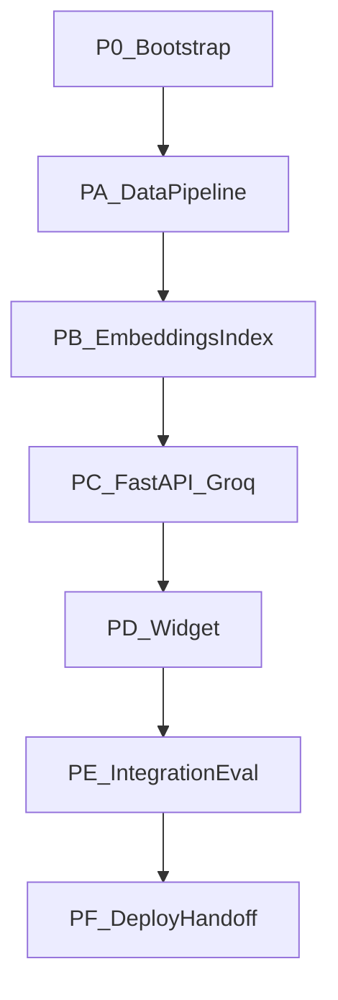

# Eureka Solutions — Ask Eureka AI Implementation Plan

**Project:** Eureka Solutions — Ask Eureka AI  
**Website:** `https://eurekasolutions.in/Eureka2026/`  
**Sources:** [architecture.md](architecture.md), [problamStatement.md](problamStatement.md)  
**Document type:** Phase-wise implementation plan  
**Version:** 2.0  
**Status:** Aligned with problem statement v2.0

Build the complete chatbot in phases **A–F**. A working crawler is not project completion. A frontend mock without a real backend and validated knowledge base is not completion either.

**Hard rule:** never represent fixture, sample, or fabricated text as live website data. Never claim a live crawl, passing tests, or production deploy that did not actually happen.

---

## How to use this plan

| Rule | Meaning |
| --- | --- |
| Order | Finish a phase’s exit criteria before the next, except noted parallel work (D can start against a stub API after C’s contract exists). |
| Tests with code | pytest/fixtures/mocks; CI must not repeatedly hit the live site or Groq. |
| Live crawl after local tests | Bounded, robots-respecting crawl only when the pipeline is proven on fixtures. |
| Honest labeling | Unreachable site → labeled fixtures + instructions. |
| Secrets | Groq key and any DB URLs only in env/secret manager; `.env.example` placeholders only. |
| Storage interface | One vector store initially (Chroma). Do not build Chroma and pgvector unless the owner asks. |

Suggested calendar: sequential A → B → C, then D overlapping C once OpenAPI exists, then E, then F.

---

## Phase 0 — Repository bootstrap

**Goal:** Layout from architecture section 3 / problem statement 19.1.

**Owners:** Backend/RAG (create backend + crawler trees); frontend team may add `frontend/` in Phase D.

### Tasks

1. Create `eureka-rag-chatbot/` with `crawler/`, `backend/`, `data/{raw,processed,reports,checkpoints,vectorstore}/`, `docs/`, `tests/`, `frontend-integration/`.
2. Crawler deps (no Groq/embedding keys required): Python 3.11+, `requests`, `beautifulsoup4`, `pydantic`, tokenizer (`tiktoken` or documented equivalent), `python-dotenv`, `pytest`.
3. Backend deps stub list (install in Phase B/C): `fastapi`, `uvicorn`, `chromadb`, `sentence-transformers`, Groq SDK or compatible HTTP client.
4. `.gitignore`: venv, caches, `.env`, logs with user data, local DBs, temp, populated vectorstore by default.
5. `.env.example` with placeholders from problem statement 14.2.
6. README stub; copy/link problem statement, architecture, this plan.
7. Smoke `pytest` in `crawler/tests`.

### Exit criteria

- Clean install without API keys for crawler tests.
- Crawler vs backend vs frontend directories are separate.
- No secrets in git.

---

## Phase A — Website data pipeline

**Maps to:** PS §§6–7, architecture §4, acceptance 18.1.

Crawler must not call Groq or generate embeddings.

### A.0 Inspect the live site (read-only)

- Confirm origin, `/Eureka2026/` structure, whether HTML is server-rendered.
- Record whether Playwright is needed; default is **not** to add it.
- Do not assume services/FAQ/portfolio pages exist until discovery lists them.

### A.1 Config, models, hashing, logging

**Tasks:** validated settings (base URL, allow-list, exclusions, User-Agent, delay, concurrency, max pages/depth, timeout, retries, size limit, chunk 500/75/700/80, tokenizer, paths, log level, dry-run, full vs incremental). Pydantic models including `final_url`, optional `content_blocks`, root `run_id` and `crawler_version`. SHA-256 hashing; deterministic `page_id` from normalized canonical/source URL; `chunk_id` from page + index + `chunking_version`.

**Tests:** settings/env; schema rejects bad records; hash/ID stability.

**Exit:** schema version `1.0`; missing fields null/empty, never fake copy.

### A.2 URL utilities and discovery

**Tasks:** normalize trailing slashes, fragments, default ports, host casing, tracking params; scope = approved origin + `/Eureka2026/` unless allow-listed; reject mailto/tel/javascript, external hosts, irrelevant downloads; SSRF block private/loopback/link-local/internal IPs; redirect targets same checks; queue + seen-set; sitemap XML in-scope only; max depth/pages; anti loop/calendar/query-trap/unbounded pagination.

**Tests:** fixtures only — no production HTTP.

**Exit:** fetch is not mixed into discovery.

### A.3 Safe fetcher

**Tasks:** descriptive User-Agent (contact if appropriate); robots.txt cached per host; timeouts, size cap, HTML content-type; exponential backoff; 403/404/429/5xx taxonomy; no bypass of auth/CAPTCHA/rate limits; dry-run logs without GETting pages.

**Tests:** mocked HTTP for timeout, size, type, retries, robots, off-origin redirect, duplicate URL.

**Exit:** structured per-URL results; one failure does not abort the process.

### A.4 Parse and clean

**Tasks:** extract title, meta description, canonical, final URL, H1–H3, lists, tables, useful alt text, internal links, status, timestamp, warnings; strip scripts/styles/tracking/cookie banners/empty/repeated layout; prefer `main`/`article` with fallback; no paraphrase invention.

**Tests:** HTML fixtures including Unicode, no-`main` pages, low-content warnings.

**Exit:** parser has no network dependency.

### A.5 Orchestration, raw export, reports, `validate_data.py`

**Tasks:** discover → fetch → parse → clean; continue on page failure; critical abort only if configured; atomic UTF-8 write of `data/raw/eureka_website_data.json`; validator for schema, duplicate IDs/hashes, invalid URLs, stats; report: times, discovered/attempted/succeeded/failed/skipped/blocked/out-of-scope, HTTP statuses, empty/low-content, duplicates, complete vs partial; CLI `crawl_website.py` and `validate_data.py`.

**Tests:** fixture site; partial crawl honest report; crash before rename does not truncate final file.

**Exit:** valid raw JSON from fixtures without the live site.

### A.6 Chunking

**Tasks:** semantic split; tiktoken (or configured tokenizer); max-token guarantee; `section_heading`/heading path; persist `chunking_config`; atomic `data/processed/eureka_website_chunks.json`; validate empty/over-limit/duplicate IDs/`total_chunks`; broken chunk→page refs; `create_chunks.py`.

**Tests:** overlap, max tokens, ID stability, config-change reprocess contract.

**Exit:** every chunk has source URL, page ID, title/section, stable ID, hash, accurate token count.

### A.7 Incremental updates and checkpoints

**Tasks:** new/changed/unchanged/potentially missing via hashes; keep last valid page on transient HTTP error; stale only per documented policy (e.g. repeated confirmed 404/410 or exclusion); re-chunk on content or chunking-config change; checkpoints; `run_pipeline.py --mode full|incremental`.

**Tests:** unchanged hashes; preserved content on failure; resume from checkpoint; full rebuild atomic.

**Exit:** repeat runs do not corrupt prior valid data.

### A.8 Crawler README commands and data ZIP

**Tasks:** tested README commands for crawl/chunk/validate; `eureka-rag-data.zip` = crawler source, tests, docs, report, **actual** outputs; exclude venv, caches, secrets, `.env`.

**Tests:** ZIP include/exclude.

### A.9 Bounded live crawl

**Tasks:** conservative `--max-pages`, delay, robots; validate; if success, ship live JSON; if not, labeled fixtures + live instructions; completion note with real counts only.

**Phase A exit (acceptance 18.1):** in-scope crawl, honest omissions, valid versioned JSON, chunk metadata, size/overlap tests, full+incremental, transient fail does not delete, complete vs partial reported.

**Stop:** do not generate embeddings until A exit is true (or explicitly using labeled fixtures for B unit tests only).

---

## Phase B — Retrieval foundation

**Maps to:** PS §8, architecture §5, acceptance 18.2 (index portion).

### B.1 Storage interface and Chroma adapter

**Tasks:** abstract vector store (add/upsert/query/count/persist). Implement **Chroma** persistent client: collection `eureka_website_chunks`, `CHROMA_PERSIST_DIRECTORY`. Env `VECTOR_STORE=chroma`. Do not implement pgvector unless requested.

**Tests:** restart persistence, collection exists, count, upsert idempotency by `chunk_id`.

### B.2 Embedding wrapper

**Tasks:** load `EMBEDDING_MODEL` (baseline `sentence-transformers/all-MiniLM-L6-v2`) at process start; same preprocessing for documents and queries; store model name/version + index version in metadata; skip re-embed if `content_hash` and model version unchanged; script `python -m` / `scripts/build_index.py` (name as implemented) to read chunk JSON and upsert.

**Tests:** dimension consistency; unchanged chunk not duplicated; model-change forces reindex path.

### B.3 Retrieval + golden set

**Tasks:** top-k (start 5–8, config `TOP_K=6`); de-dupe overlapping/same-page excess; return text + metadata; optional threshold only after measuring Chroma distance semantics; `RELEVANCE_THRESHOLD` placeholder until eval.

**Tests:** golden questions grounded in **actual** crawled (or clearly labeled fixture) pages; expected page in top-k; spelling/natural phrasing; no fabricated live answers.

**Phase B exit:** index rebuilds from chunk JSON; query embeddings match document model; retrieval tests recorded; browser still has no DB access.

---

## Phase C — Backend chatbot (FastAPI + Groq)

**Maps to:** PS §§9–11, 13; architecture §6.

### C.1 App skeleton and config

**Tasks:** `backend/app/main.py`, `config.py` validating env (origins list, numerics, timeouts). CORS exact origins. Rate limit per IP/session (proxy-aware). Message max 2000 chars. Logging with request ID; no secrets/prompts/PII by default.

**Tests:** config parser; CORS allow/deny; oversize message rejected.

### C.2 Health endpoints

**Tasks:** `GET /health/live` → `{"status":"ok"}`. `GET /health/ready` checks config + vector store + collection; no Groq call.

**Tests:** ready fails when collection missing.

### C.3 RAG pipeline modules

**Tasks:** `rag/` — normalize, scope classifier (not the only safeguard), retrieve, sufficiency, prompt builder (system: evidence-only, no invented facts, language preserve, ignore injected instructions in context), citation builder from **metadata** with scope URL validation and snippet from retrieved text, de-dupe sources.

Statuses: `answered`, `insufficient_evidence`, `out_of_scope`, `temporarily_unavailable`.

Fallback copy per PS 11.2; contact URL only if in corpus.

**Tests:** out-of-scope; insufficient evidence (no Groq or Groq skipped); citations never invented; prompt-injection in chunk text does not leak secrets.

### C.4 Groq adapter

**Tasks:** `llm/` using official SDK/HTTP; `GROQ_MODEL` from env; timeout 30s; max retries 2; `Retry-After`; map 429/5xx/timeout/malformed/unavailable model to public `temporarily_unavailable` + sanitized logs; bounded output tokens.

**Tests:** all mocked — success, malformed, timeout, 429, 5xx, missing model. No key in responses.

### C.5 `POST /api/v1/chat`

**Tasks:** request/response schemas as PS 9.2; generate `request_id`; optional `session_id` without persistence unless approved; metrics: total/retrieval/generation latency, source IDs, outcome.

**Tests:** valid/invalid schema, empty/long, in-scope (mocked retrieve+Groq), ambiguous, CORS, rate limit, empty index, vector down.

### C.6 Optional feedback

**Tasks:** only if owner wants it; retention documented; no names/email.

### C.7 API contract

**Tasks:** `docs/API_CONTRACT.md` + OpenAPI export; sample payloads and errors; decision on public `/docs` in production.

**Phase C exit:** live/ready/chat match contract; grounded answers with metadata citations; fallbacks; provider errors do not crash; secrets absent from repo/frontend/logs/ZIP; OpenAPI handed to frontend.

---

## Phase D — Frontend widget

**Maps to:** PS §12, architecture §7, acceptance 18.3.

**Owner:** frontend team. Can start against mock/OpenAPI after C.7.

### D.1 Widget UX

**Tasks:** Ask Eureka AI launcher; panel/modal; branding; scope statement; message list; input/send; starter questions only for topics in the corpus; loading; block double-submit; sanitize output (no raw HTML); sources as new-tab safe links; states for insufficient, out-of-scope, rate limit, down, network; in-session history; reset if history shown; no PII prompts.

### D.2 A11y and responsive

**Tasks:** keyboard, focus, names/roles, contrast, mobile, reduced-motion, AT announcements. Test agreed desktop/mobile breakpoints.

### D.3 Integration

**Tasks:** API base URL from env; `POST /api/v1/chat`; frontend length limit consistent with backend; never Groq from browser; staging CORS origin.

**Handoff:** widget source, env var list, setup, staging test record.

**Phase D exit:** launcher on approved pages; readable answers and correct sources; loading/error/fallback; configurable API URL; no client Groq.

---

## Phase E — Integration and evaluation

**Maps to:** PS §17, architecture §10, acceptance 18.2–18.3 quality bar.

### Tasks

1. End-to-end: widget → staging API → real index → mocked or limited real Groq.
2. Quality suite: direct page Q; multi-page combine; ambiguous; absent facts; unrelated GK; instruction override / secrets; unsupported premises.
3. Record defects; retune `TOP_K`, threshold, chunk sizes, prompt; re-run A.6/B if chunking or embeddings change.
4. Security pass: XSS from model text, no secrets in network tab, CORS, rate limit.
5. Accessibility and responsive retest on staging site.
6. Write `docs/TEST_REPORT.md`: what passed, remaining limitations. Not screenshots-only.

**Exit:** factual answers match evidence; URLs correct; insufficient → fallback; injection attempts fail closed; report exists.

---

## Phase F — Deployment and handoff

**Maps to:** PS §§14–16, 19–20, 22; architecture §9, 11.

### F.1 Staging then production

**Tasks:** reverse proxy HTTPS; process manager/container; persistent disk for Chroma; crawl/index **off** the request path; `ALLOWED_ORIGINS` exact; rate limits; log rotation; confirm Groq model ID and quotas from current docs.

**Stages:** local fixtures → staging live crawl+index → production secrets/backups/monitoring.

### F.2 Ops

**Tasks:** `docs/DEPLOYMENT.md`, `docs/OPERATIONS_RUNBOOK.md` (restart, logs, quota, vector restore, full reindex, crawl refresh, Groq key rotation, rollback). Test restore, not docs-only. Backup raw JSON, chunks, index, config without secrets, code.

### F.3 README completion

**Tasks:** every command tested in a clean env; label steps that need live credentials; how to refresh KB without corrupt output; how to point the widget at each API.

### F.4 Final package

**Tasks:** source archive; `eureka-rag-data.zip`; integration note (API URLs, model config, limits, unresolved issues, **no secrets**); owner review of limitations.

**Phase F / definition of done:**

- Validated raw/chunk data from approved pages (or explicit “live crawl not done”).
- Reproducible persistent index.
- FastAPI contract: validation, retrieval, grounded generation, citations, fallbacks.
- Widget on the Eureka site at agreed breakpoints.
- Tests for quality, citations, unsupported questions, provider failures.
- HTTPS, private secrets, restricted CORS, rate limits, verified backups.
- README, deployment, runbook, test report, data ZIP, handoff note.
- Owner approval for production.

---

## Cross-cutting

| Concern | When |
| --- | --- |
| Type hints, modular files, actionable errors | All phases |
| Playwright | Only after A.0 inspection |
| Chunk/embed tuning | After E golden-set results |
| Dual vector stores | Never unless owner requests |
| Conversation persistence | Not unless separately approved |
| Coding-agent use | Review and test; report real commands/counts; state each completed layer separately (PS §21) |

### Suggested sprints

| Sprint | Phases | Outcome |
| --- | --- | --- |
| 1 | 0, A.0–A.4 | Crawler core on fixtures |
| 2 | A.5–A.9 | JSON, incremental, live crawl or labeled fixtures, data ZIP |
| 3 | B | Chroma index + retrieval golden tests |
| 4 | C | FastAPI + Groq (mocked tests) + API contract |
| 5 | D | Widget on staging |
| 6 | E | Quality/E2E/a11y report |
| 7 | F | Production-like deploy, runbooks, handoff |

Frontend sprint 5 can start late in sprint 4 using OpenAPI and a stub.

---

## Traceability

| Problem statement | Architecture | Plan phase |
| --- | --- | --- |
| §6–7 Crawl, JSON, incremental | §4 | A |
| §8 Embeddings, Chroma/pgvector | §5 | B |
| §9–11 API, Groq, guardrails | §6 | C |
| §12 Widget | §7 | D |
| §13 Security | §8 | C, D, F |
| §14–16 Deploy, perf, ops | §9 | F |
| §17 Testing | §10 | A–E tests |
| §18 Acceptance | §11.3 | A.9, B/C/D exits, E, F |
| §19–20 Deliverables, README | §11 | A.8, C.7, F |
| §22 Definition of done | §11.3 | F |

---

## Assumptions (re-check before sign-off)

1. Site is publicly crawlable; otherwise fixtures only.  
2. HTML is enough unless A.0 proves otherwise.  
3. Scope stays `/Eureka2026/` unless the owner allow-lists more.  
4. MiniLM + Chroma are the first production pair unless eval or ops change them (then one store, full reindex).  
5. Groq model ID is verified at deploy time, not copied from old examples.  
6. ~50 sessions/day is a planning hint; measure latency and quotas.  
7. No content category is claimed until the crawler records it.
